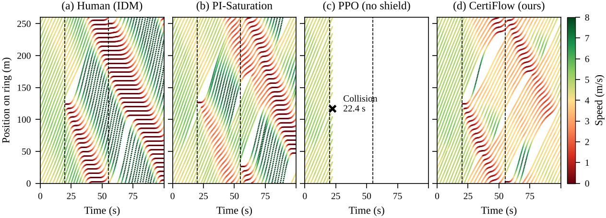

# CertiFlow: Certified multi-agent reinforcement learning for safe and stable mixed-autonomy traffic

CertiFlow trains connected autonomous vehicles (CAVs) with a shared multi-agent PPO policy to dissolve stop-and-go waves in human-driven traffic. Three layers of assurance are built in:

1. **STL specifications.** Requirements are written once in Signal Temporal Logic. They define the reward through their quantitative robustness and are checked on test episodes with exact Clopper–Pearson bounds.
2. **Conformal cooperative CBF shield.** A discrete-time control barrier function protects each CAV and the human driver behind it. Adaptive conformal prediction bounds human accelerations, and the safe action set is an interval computed exactly by bisection.
3. **Collective-stability certificate.** The spectral radius of the linearised closed-loop traffic map certifies that the shielded traffic system is locally exponentially stable.

The implementation is written in Python with no deep-learning framework dependencies, with SUMO experiments using Eclipse SUMO.

<p align="center">
  <br>
  <em>Space-time diagrams under emergency braking .</em>
</p>

## Repository structure

```
CertiFlow/
├── certiflow/              core library
│   ├── env.py              vectorised ring-road simulator (noisy IDM humans + CAVs, domain randomisation)
│   ├── shield.py           conformal cooperative discrete-time CBF shield, adaptive conformal inference
│   ├── stl.py              STL robustness semantics and the traffic specifications (Table 4)
│   ├── ppo.py              MLP, Adam and MAPPO (shared actor, centralised critic, GAE)
│   ├── certify.py          spectral stability certificate (Algorithm 4), Clopper–Pearson bound
│   ├── baselines.py        human-only IDM and PI-with-saturation controllers
│   └── methods.py          configuration of every compared method and ablation
├── train.py                PPO training on the ring (Algorithm 3, lines 1–12)
├── sumo_train.py           safe online fine-tuning in SUMO (Algorithm 3, line 13)
├── evaluate.py             baselines, ablations, penetration study, certificates
├── evaluate_dr.py          domain-randomised and fine-tuned policies
├── evaluate_main.py        full metric set and test-time ablations of the final policy
├── exp_sweeps.py           human-uncertainty and shield-parameter sweeps
├── exp_extra.py            runtime, safe-set phase portrait, SUMO residuals and trajectories
├── sumo_eval.py            SUMO ring and highway-merge evaluation (TraCI)
├── make_tables.py                           -> tables/
├── make_figures.py         figures         -> figures/
├── make_thumbnails.py      inset plots of Fig. 2       -> figures/
├── demo.py                 quick check of a trained policy
├── tests.py                self-checks
├── run_all.sh              full reproduction pipeline
├── runs/                   27 trained policies with training logs
├── results/                raw per-episode results, certificates and traces
├── tables/                 generated tables
└── figures/                generated figures (PDF and PNG)
```

## Installation

Python 3.10 or newer is required.

```bash
pip install -r requirements.txt
python tests.py
```

`tests.py` runs six checks in about one minute: exact backpropagation, the STL window semantics, Lemma 2 (braking feasibility) on a dense state grid, the shield blocking a reckless policy, the instability of the human-only ring (ρ = 1.0108), and the Clopper–Pearson bound.

**SUMO (optional).** This is needed only for `sumo_eval.py`, `sumo_train.py` and part of `exp_extra.py`. The experiments used Eclipse SUMO 1.28. SUMO is found through the `SUMO_HOME` environment variable or the `eclipse-sumo` Python package:

```bash
pip install eclipse-sumo traci          # or: export SUMO_HOME=/path/to/sumo
```

## Quick start

The trained policies are included in `runs/`, so the main results can be checked without training:

```bash
python demo.py
```

```
scenario       shield  collisions  wave (m/s)  speed (m/s)  interv.
S1-nominal     on            0/20       0.099         4.87    0.022
S1-nominal     off           4/20       0.099         4.91    0.000
S2-shift       on            0/20       0.213         4.67    0.077
S2-shift       off          14/20       0.200         4.87    0.000
S3-emergency   on            0/20       1.104         3.57    0.131
S3-emergency   off          20/20          --           --    0.000

spectral radius, human-only ring: 1.0108  (unstable)
spectral radius, CertiFlow     : 0.9763  (certified stable, barrier margin at equilibrium 2.30 m)
```

To regenerate every table and figure from the stored results (about one minute):

```bash
python make_tables.py && python make_figures.py && python make_thumbnails.py
```

## Reproducing

**1. Training on the ring** 

```bash
for s in 0 1 2; do
  for m in PPO PPO+CBF CertiFlow CertiFlow-noSTL CertiFlow-noCoop CertiFlow-noACI; do
    python train.py --method $m --seed $s
  done
  python train.py --method PPO --dr --seed $s          # PPO-DR
  python train.py --method CertiFlow --dr --seed $s    # CertiFlow-DR
done
```

**2. Safe fine-tuning in SUMO** (requires SUMO)

```bash
for s in 0 1 2; do python sumo_train.py --init CertiFlow-DR --seed $s; done   # -> runs/CertiFlow-DR-FT_s*
```

**3. Evaluation and experiments**

```bash
python evaluate.py          # results/episodes.csv, summary.csv, certificates.json, traces_S3.npz
python evaluate_dr.py       # results/episodes_dr_numpy.csv, episodes_s4_ft.csv, certificates_dr.json
python evaluate_main.py     # results/episodes_main.csv
python exp_sweeps.py        # results/sweep_uncertainty.csv, sweep_sensitivity.csv
python exp_extra.py phase   # results/phase.npz
# requires SUMO:
python sumo_eval.py --scenario ring --episodes 10        # results/sumo_ring_episodes.csv
python sumo_eval.py --scenario highway --episodes 3      # results/sumo_highway_episodes.csv
python exp_extra.py runtime residuals sumo_traces        # results/runtime.json, residuals.npz, sumo_traces.npz
```

**4. Tables and figures**

```bash
python make_tables.py && python make_figures.py && python make_thumbnails.py
```

### Result

| Figures | Code | Data |
| --- | --- | --- |
| Fig. 2 (insets) | `make_thumbnails.py` | `traces_S3.npz` |
| Fig. 4 | `make_figures.py learning` | `runs/*/log.csv` |
| Fig. 5, Fig. 6 | `make_figures.py spacetime timeseries` | `traces_S3.npz` |
| Fig. 7 | `make_figures.py phase` | `phase.npz` |
| Table 6, Table 7, Table 10, Fig. 8 | `make_tables.py`, `make_figures.py robustness` | `episodes_main.csv` |
| Fig. 9 | `make_figures.py overall` | `episodes.csv`, `episodes_dr_numpy.csv`, `episodes_s4_ft.csv` |
| Fig. 10 | `make_figures.py certificate` | `certificates.json`, `certificates_dr.json` |
| Fig. 11 | `make_figures.py residuals` | `residuals.npz` |
| Table 8, Fig. 12, Fig. 13 | `make_tables.py`, `make_figures.py sumo_spacetime sumo` | `sumo_ring_episodes.csv`, `sumo_highway_episodes.csv`, `sumo_traces.npz` |
| Table 9 | `exp_extra.py runtime` | `runtime.json` |
| Fig. 14, Fig. 15 | `make_figures.py uncertainty sensitivity` | `sweep_uncertainty.csv`, `sweep_sensitivity.csv` |
| Fig. 16 | `make_figures.py coverage` | computed from the trained policy |

The values in Table 9 depend on the hardware. The stored `runtime.json` was measured on the workstation described in the draft.

## Method names

The method names used in the code map to the names in the draft as follows:

| Code | draft |
| --- | --- |
| `Human (IDM)`, `Human (EIDM)` | Human drivers |
| `PI-Saturation` | PI-Saturation |
| `PPO` | PPO (heuristic headway penalty, no shield) |
| `PPO-DR` | PPO-DR (domain-randomised training) |
| `PPO+CBF` | PPO + nominal CBF |
| `PPO+CF-shield (post-hoc)` | PPO + our shield (post hoc) |
| `CertiFlow` | CertiFlow w/o DR (ablation ii) |
| `CertiFlow-noSTL`, `-noCoop`, `-noACI` | ablations iii–v |
| `CertiFlow-DR` | CertiFlow w/o fine-tuning (ablation i) |
| `CertiFlow-DR-FT` | **CertiFlow (ours)**, the final policy |
| `Ours w/o shield`, `Ours w/o conformal (nominal CBF)`, ... | test-time ablations vi–ix |

Test scenarios: `S1-nominal`, `S2-shift` (±30 % parameter spread, noise 0.6 m/s²), `S3-emergency` (two 6 m/s² brakes for 3 s at t = 20 s and t = 55 s), `S4-penetration` (1–4 CAVs). Each method is evaluated with three training seeds × 20 test episodes per scenario.

## Trained policies and results

Each `runs/<method>_s<seed>/` folder contains `policy.pkl`, which holds the actor and critic weights and the observation normalisation as NumPy arrays, and `log.csv`, which holds the training curve. A policy can be loaded with

```python
from evaluate import load_agent
agent = load_agent("CertiFlow-DR-FT", seed=0)
action, _ = agent.act(obs, deterministic=True)   # obs: (..., 10); acceleration = action * agent.act_scale
```

The `results/*.csv` files contain one row per test episode. The columns are:

| Column | Meaning |
| --- | --- |
| `collision` | episode had a collision |
| `min_gap`, `min_ttc` | smallest gap (m) and time-to-collision (s) among all vehicles |
| `std_v_ss` | steady-state wave amplitude (m/s) |
| `mean_v` | mean speed (m/s) |
| `energy_MJkm` | tractive energy (MJ/km) |
| `cav_mean_abs_jerk` | mean absolute CAV jerk (m/s³) |
| `interv_rate` | shield intervention rate |
| `infeasible_steps` | steps on which the cooperative constraint was infeasible |
| `miscoverage` | conformal miscoverage |
| `rho_phi_*` | STL robustness of each specification (> 0 means satisfied) |

## Main parameters

| Parameter | Value | Parameter | Value |
| --- | --- | --- | --- |
| Ring length L | 260 m | CBF rate γ | 0.3 |
| Vehicles N / CAVs K | 22 / 2 | Margin d₀ | 2 m |
| Simulation step Δt | 0.1 s | Reaction allowance τ | 0.3 s |
| Control period ΔT | 0.5 s | Braking limit b | 7 m/s² |
| Episode / warm-up | 100 s / 60 s | Conformal level α | 0.01 |
| PPO iterations | 300 | ACI rate η | 0.005 |
| Fine-tuning iterations | 80 | Bisection steps | 25 |
| Parallel rings / rollout | 16 / 128 | Learning rate | 3 × 10⁻⁴ |
